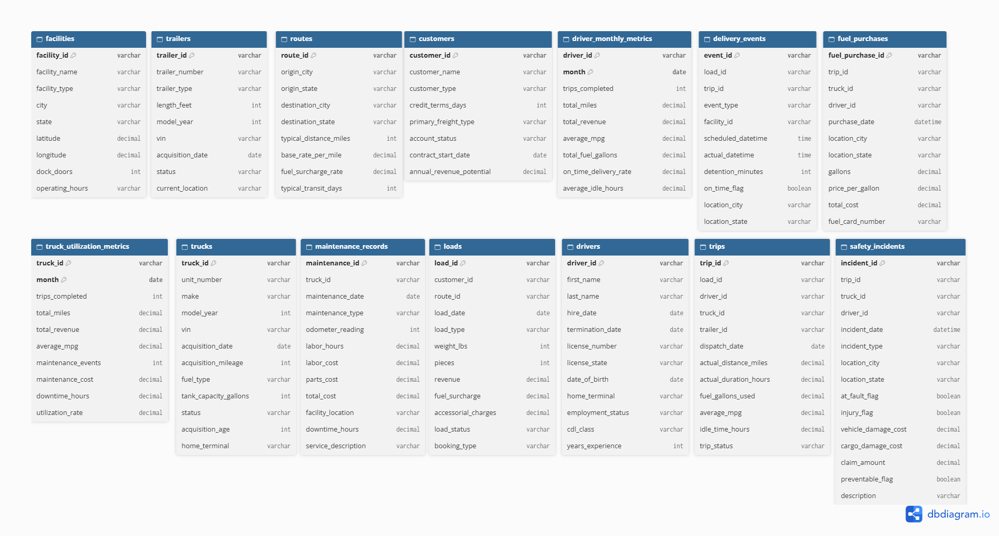

# Project Background
This project analyzes a simulated dataset from a logistics company, created for training purposes. Acting as a data analyst supporting the operations team, this project examined delivery events and fleet records to identify bottlenecks in the day to day processes of the company. All names, figures and records are fictional.

Insights and recommendations are provided on the following key areas:

- **Maintenance Performance:** Evaluation of historical maintenance events of the fleet, focusing on maintenance cost. 
- **Fuel & Fleet Utilization:** Analysis of fuel efficiency across the fleet, and factors contributing to increased consumption.
- **Route Profitability:** An assessment of our routes and income generated. 
- **Driver performance:** Evaluation of driver performance focusing on on-time delivery rate.

[View the dashboard (PDF)](Dashboard/Logistics_dashboard.pdf)

# Data Structure

The company's main database structure as seen below consists of fourteen tables, with a total row count of 549,708 records.

[View the full data dictionary](Documents/Data_dictionary.xlsx)

# Executive Summary

### Overview of Findings

Explain the overarching findings, trends, and themes in 2-3 sentences here. This section should address the question: "If a stakeholder were to take away 3 main insights from your project, what are the most important things they should know?" You can put yourself in the shoes of a specific stakeholder - for example, a marketing manager or finance director - to think creatively about this section.

[Visualization, including a graph of overall trends or snapshot of a dashboard]

# Insights Deep Dive
### Category 1:

* **Main insight 1.** More detail about the supporting analysis about this insight, including time frames, quantitative values, and observations about trends.
  
* **Main insight 2.** More detail about the supporting analysis about this insight, including time frames, quantitative values, and observations about trends.
  
* **Main insight 3.** More detail about the supporting analysis about this insight, including time frames, quantitative values, and observations about trends.
  
* **Main insight 4.** More detail about the supporting analysis about this insight, including time frames, quantitative values, and observations about trends.

[Visualization specific to category 1]

### Category 2:

* **Main insight 1.** More detail about the supporting analysis about this insight, including time frames, quantitative values, and observations about trends.
  
* **Main insight 2.** More detail about the supporting analysis about this insight, including time frames, quantitative values, and observations about trends.
  
* **Main insight 3.** More detail about the supporting analysis about this insight, including time frames, quantitative values, and observations about trends.
  
* **Main insight 4.** More detail about the supporting analysis about this insight, including time frames, quantitative values, and observations about trends.

[Visualization specific to category 2]

### Category 3:

* **Main insight 1.** More detail about the supporting analysis about this insight, including time frames, quantitative values, and observations about trends.
  
* **Main insight 2.** More detail about the supporting analysis about this insight, including time frames, quantitative values, and observations about trends.
  
* **Main insight 3.** More detail about the supporting analysis about this insight, including time frames, quantitative values, and observations about trends.
  
* **Main insight 4.** More detail about the supporting analysis about this insight, including time frames, quantitative values, and observations about trends.

[Visualization specific to category 3]

### Category 4:

* **Main insight 1.** More detail about the supporting analysis about this insight, including time frames, quantitative values, and observations about trends.
  
* **Main insight 2.** More detail about the supporting analysis about this insight, including time frames, quantitative values, and observations about trends.
  
* **Main insight 3.** More detail about the supporting analysis about this insight, including time frames, quantitative values, and observations about trends.
  
* **Main insight 4.** More detail about the supporting analysis about this insight, including time frames, quantitative values, and observations about trends.

[Visualization specific to category 4]

# Recommendations:

Based on the insights and findings above, we would recommend the [stakeholder team] to consider the following: 

* Specific observation that is related to a recommended action. **Recommendation or general guidance based on this observation.**
  
* Specific observation that is related to a recommended action. **Recommendation or general guidance based on this observation.**
  
* Specific observation that is related to a recommended action. **Recommendation or general guidance based on this observation.**
  
* Specific observation that is related to a recommended action. **Recommendation or general guidance based on this observation.**
  
* Specific observation that is related to a recommended action. **Recommendation or general guidance based on this observation.**
  

# Assumptions and Caveats:

Throughout the analysis, multiple assumptions were made to manage challenges with the data. These assumptions and caveats are noted below:

* Assumption 1 (ex: missing country records were for customers based in the US, and were re-coded to be US citizens)
  
* Assumption 1 (ex: data for December 2021 was missing - this was imputed using a combination of historical trends and December 2020 data)
  
* Assumption 1 (ex: because 3% of the refund date column contained non-sensical dates, these were excluded from the analysis)
